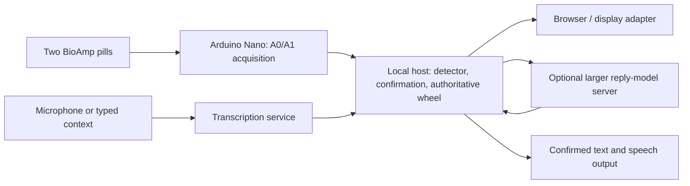

# Gaze, blink confirmation, and reply design

Updated 2026-10-10. Experimental implementation on the detection branch;
software verification is not a live wearer result. Soldering is paused until
wire and insulation are available. The completed free-wheel recording was
stopped and preserved; no accuracy score is claimed for that unlabeled session.

## Tonight's deliverable

A wearer chooses a reachable item with a cardinal eye movement, returns to
center, and deliberately double blinks to activate it. Confirmed phrases appear
on the companion and can speak through its existing speech pipeline. The browser
enables speech on that companion when the operator clicks Start gaze + double-blink
communication. Single natural blinks do nothing. A refresh resets speech to off;
Enable speech turns it back on without restarting communication.

Start **gaze + double-blink communication** on the homepage. This is a separate,
explicit opt-in from the diagnostic eye-wheel test. The default app remains
unchanged. This requires live serial input and a frozen waveform profile. Do not
start guided acquisition or speed cues at the same time. Stop communication or
use the existing Stop eye wheel test button to exit. Recenter cancels a pending
choice. Nothing automatically starts on application launch.

The communication wheel exposes only four positions:

The homepage **Default choices** button restores a fixed Home phrase set:
Hello, Goodbye, Yes, No and Help. In eye-control mode the first page has
Hello on the left, Goodbye on the right, More above and Back below. More
advances to Yes/No, then Help. The same canonical state reaches the OLED mirror.
The button clears the displayed transcript and any pending confirmation, returns
to page one, and does not confirm or speak anything. It preserves the conversation
partner, prior confirmed speech/history, and detector settings/state. A generation
already running cannot overwrite this reset. Listen/Text can generate replies again.

| Gaze | Item |
| --- | --- |
| Left | First reply on this page |
| Right | Second reply on this page |
| Up | More replies, disabled on the final page |
| Down | Back, using the existing application's navigation behavior |

Changed 2026-10-10 evening (was up/right replies, left More). In live use left/right
were accepted reliably while up/down were often rejected or confused with blinks,
which share the vertical channel. Replies now need only the horizontal axis.

Two replies per page make all phrase options reachable without diagonal
classification. Diagonal slots and spelling are unavailable in this temporary
layout. Normal eight-slot keyboard/mouse mode remains available after stopping.
On Home, the existing Back operation enters Needs and confirms "Give me a moment."
Back from Needs returns Home. This behavior should be revisited for the final UX.

Gaze highlighting remains removed. A fixed Detected choice card above the wheel shows the full text; the center
shows the chosen label and Return to center / Ready to confirm status. The
companion phone continues to show confirmed speech, not pending choices. A short label must not hide what will actually be spoken.

## Legacy template confirmation rules

These rules describe the mode without `--eog-pulse-confirmation`. The independent
pulse mode and retry behavior below supersede its blink matching/cancellation rules.

- A newly accepted gaze at an enabled item creates a pending choice.
- Confirmation arms after navigation becomes Ready, or after a classified
  opposite return and about 250 ms of buffered settling. This separates blink
  readiness from the longer navigation recovery. Horizontal returns require
  horizontal settling; vertical returns require both axes to settle first.
  Once armed, vertical blink activity does not disarm the choice. A later
  classified movement cancels it. This is electrical return evidence, not an
  absolute eye-position measurement.
- A double-blink waveform must begin after the signal-based arming time.
  Buffered settling can precede the delayed return classification; blinks before
  that settling time still cannot confirm.
- The frozen profile must label it double_blink, with distance <= .08,
  competing-label distance ratio >= 1.5, and horizontal energy fraction <= .25.
  A second, narrower allowance accepts distance <= .2 only with ratio >= 2.5
  and horizontal energy fraction <= .1. This tolerates larger waveform differences
  only when class separation and vertical dominance are stronger.
  These are engineering defaults, not validated blink accuracy thresholds.
- Single blinks are not paired by a timer in this mode; a classified double-blink
  waveform is required. A one-second window may miss more widely spaced pairs.
- A choice expires ten seconds after its gaze event. Uncertainty, clipping,
  recentering, stale input, changed text/contact/selection, or manual navigation
  invalidates it. A doubtful double blink cancels it and requests another gaze.
- A confirmed choice is consumed before activation. A later double blink cannot
  repeat speech without a new accepted gaze.

The detection window remains one second. Return-to-center recovery and deliberate
confirmation add time. This implementation does not promise a two-second total
interaction or implement two-second dwell. AC-coupled signals settling do not
prove that the eyes are physically centered; the wearer must follow the prompt.

## Phrase versus word options

Assumption pending clarification: two seconds means approximate interaction
cost, rather than a requested dwell timer.

| Strategy | Example | Selection cost and role |
| --- | --- | --- |
| Preset phrases | "Yes", "No", "I need help" | Fast, available immediately and offline; first demo priority |
| Contextual full replies | Asked "Want water?", offered "Yes, please" / "Not right now" | One confirmation per reply, plus any paging; preview and approval required |
| Next-word composition | "I" then "want" then "water" | Several confirmations, plus correction and Speak; later optional composition mode |

At two seconds per confirmed word, six words already cost roughly twelve
seconds before browsing, corrections and speaking. One confirmed full reply
could cost roughly two seconds under that assumption. Neither estimate is a
measured throughput result. Two-second gaze dwell should not be implemented from
these AC-coupled signals without a separate held-gaze validation.

Recommended first demo: presets first; request contextual sentence suggestions
when the other person's speech/text is available. Retain presets during generation
and on failure. Never automatically speak an AI suggestion. Keep choice text
stable through confirmation; changing the choices invalidates a pending gaze.
Next-word generation and a revised Back action remain design decisions.

## Arduino Nano versus Jetson Orin Nano

The Arduino Nano acquires A0/A1 and streams samples; it is not the sentence model
host. The Jetson is a separate Linux computer. Proposed split:

Keep detection and wheel navigation independent of model/network availability.
Run one authoritative Application/RingState, initially on the tested laptop;
move it to Jetson only after serial, dependencies and audio checks there.
Do not send raw EOG to the sentence model. Remote replies may reduce Jetson
memory pressure but add network delay; measure rather than promise lower latency.
Jetson Orin Nano Super has 8 GB shared memory and supports generative AI;
which model fits depends on model size, quantization and other running services.
[NVIDIA specification](https://developer.nvidia.com/blog/nvidia-jetson-orin-nano-developer-kit-gets-a-super-boost/).

The existing OllamaSuggestions client accepts OLLAMA_URL and OLLAMA_MODEL and can
call an Ollama-compatible model server through an SSH tunnel. Example proposal:
local tunnel port 11435 -> server loopback port 11434; set
OLLAMA_URL=http://127.0.0.1:11435 and the actual installed model name, then restart.
Server access, hardware/model inventory and benchmark remain unprovided; no
remote service was provisioned. Do not assume any arbitrary cloud API implements
the same endpoint or authentication. ASR_URL is separately configurable.

Existing suggestions are asynchronous relative to acquisition and are rejected
if the conversation revision changed while generating. Further improvement:
queue refreshed choices until no choice is pending, so a delayed reply update
doesn't force a retry. No speculative next-word model or model switch was added.

## Acceptance checkpoint

1. Desk test with speech off: choose Up, return to Ready, double blink; expect one
   confirmed reply. Repeat with Right and More, then Back.
2. Natural single blinks and double blinks before any gaze must not activate.
3. Blink during return, diagonal/uncertain gaze, recenter, and disconnect must not
   confirm an old choice. A new gaze must be required afterward.
4. Enable speech once: one confirmed reply produces one utterance, not repeats.
5. Test with reply-model service unavailable: presets and gaze still work.
6. Record intended actions and observed confirmations, including misses and false
   selections. Existing navigation recordings do not establish blink-confirmation
   accuracy. Physical OLED synchronization and glasses optics remain unverified.

## Verification

182 unit/integration tests: 181 passed, one optional NumPy test skipped.
New tests cover recovery, single blinks, ambiguous/early double blinks, expiry,
changed content/contact, one-shot activation, four-position paging and ingest
integration. HTTP/browser simulation passed, including one confirmed browser utterance with
simulated speech playback and no paid API calls. It checks presentation and dispatch, not live
signal accuracy. See the private artifacts/browser-report/eog report for its
latest result.

## Double-blink rejection review

The wearer reported deliberate double blinks being marked uncertain. In the
latest private live event log inspected, 13 events were classified double_blink.
The original match gate admitted two waveform candidates; the revised gate
admits four. These are waveform eligibility counts, not four confirmations or
an accuracy score: pending-choice, recovery and onset conditions still apply.

Replaying the three reviewed recordings through the frozen all-data profile
produced the same eligible-event counts under old and selected revised rules:
four during the double-blink movement cues, no additions during single-blink
movement cues, and unchanged candidates in baseline/prepare/return periods.
An intermediate ratio >= 2 rule added a baseline candidate and was tightened to
>= 2.5. This tuning reuses development data and is not independent validation.
Existing baseline candidates remain a reason to validate false confirmations.
Private report: recordings/blink-policy-review.json.

Double-blink events now log confirmation_result: selected, no_pending_choice,
return_to_center_first, early_blink, or uncertain_blink_match. No new live wearer
result is claimed after this adjustment.

## Recovery-blocking bug found in the next live session

The wearer reported worse usability and double blinks still not selecting. The
next session logged recognized, strongly matched double blinks rejected as
return_to_center_first. Vertical blink masks repeatedly cleared the full quiet
period, and the app started a further settling wait after the one-second return
classifier had already buffered the return. The prior distance allowance did not
address this interaction defect.

GuidedEOGTest now retains the last two seconds of filtered frames and the
opposite-return onset. Confirmation can arm from a contiguous ~250 ms settling
interval after that return, independently of navigation recovery. Once armed,
a blink's own vertical activity does not restart settling. Subsequent classified
movement, uncertainty, faults, changed content and expiry still cancel it.
Direction matching, its thresholds, profile and single-blink behavior are unchanged.

Raw-only old/new replay of the first enabled interval in the latest recording
produced two versus six activations, one versus five phrase confirmations, and
16 versus six double blinks blocked waiting for return. UI actions are not in
the replay and intended actions are unlabeled; these are behavior differences,
not accuracy estimates or proof of correct activations. Private report:
recordings/recovery-confirmation-review.json.

A simulated communication replay of the three reviewed recordings produced
unchanged selection counts: two in prepare intervals for session4, none in
session5, two in double-blink cues for session6. Existing prepare selections are
a false-confirmation risk and are not dismissed. Frozen all-data profile and
reused data limit this check. Private report: recordings/confirmation-regression-review.json.

The live diagnostic session also logged five clipping resets and thirteen
rejected movements. These counts do not establish direction accuracy; rails and
contact/movement artifacts can interrupt operation. No new wearer result is
claimed for the recovery fix. Next checkpoint: one known reply, return, confirm
with speech off, then natural blinks/no-choice checks.

### 2026-10-10: double-blink ambiguity instrumentation

The latest explicit right → center → double-blink attempt reached an armed gate but failed the single-versus-double template margin (1.218 versus 1.5). Waveform events now include completed vertical-pulse count, widths, separation, ratio and valley diagnostics. These are observational only; selection thresholds remain unchanged pending exact-window replay. Some reused single-blink/direction windows also contain two lobes, so pulse count alone must not authorize selection. Confirmation armed indices now use the same logging coordinate as onset/emitted indices. See `CLAUDE_HANDOFF.md` for the exact event, replay alignment blocker and next experiment.

### Speech on communication start

Starting communication now enables speech on the companion through the same user click.
The local `.env` configures ElevenLabs: confirmed replies use cloud TTS with a local
cache and browser speech fallback. No credentials are stored in these docs. Browser
audio policy can still require interaction; this is not an audible hardware test.
The speech toggle can pause output; refresh starts with speech off. Diagnostic mode
continues to disable speech. Automated browser checks use mocked browser speech and
disable the cloud API key, so they never call paid TTS.

### Independent pulse confirmation (opt-in)

`--eog-pulse-confirmation --eog-profile PATH` enables the new candidate. The legacy
one-second gaze classifier still handles directions, while a parallel 50 Hz stream
keeps observing blinks during its cooldown. Two completed positive pulses must have
fast rise/fall velocities, bounded width/duration, comparable slopes, low horizontal
energy, a separated valley and 150–650 ms peak spacing. Thresholds use resting MAD
noise with absolute floors. A third pulse rejects the cluster; emission waits through
the third-pulse interval and quiet recovery. Clipping, gaps and recenter reset pairing.

Confirmation requires both that pair and a pulse-anchored one-second template match:
distance <= .08, direction separation >= 2, horizontal energy fraction <= .15.
Template-only double-blink labels cannot select in this mode. Existing fresh-choice,
return/arming, onset, expiry, content-change and one-shot protections remain.
These thresholds were selected using reused development evidence, not held-out
wearer validation. The default command line still uses legacy confirmation unless
this explicit flag is supplied.

Exact failed interaction replay now selects once at sample 16532 instead of missing
at 16622; zero false confirmations were observed within that identified interaction.
Across complete reviewed recordings using the frozen all-data profile, baseline
versus pulse mode selections by onset cue phase are:

| Recording | Legacy | Pulse mode |
| --- | --- | --- |
| Session 4 | 1 return + 1 prepare (both false-confirmation risks) | 0 |
| Session 5 | 0 | 0 |
| Session 6 | 2 during double-blink movement cues | 2 during double-blink movement cues |

This is a simulated communication replay of acquisition protocols, which did not
instruct a gaze-confirm sequence. Selection misses are therefore not identifiable
from these cue files. Raw pair detection found three of five session-6 double-blink
cues and missed two; baseline/prepare pair candidates also exist but failed the full
gate. It does not establish zero false confirmations in future natural blinking.
Private report: `recordings/pulse-confirmation-runtime.json`; reproduce with
`scripts.eog_pulse_confirmation_review`. Software tests cover single/widely spaced
blinks, triples, up/return, mixed axes, no choice, early/during-return blink, expiry,
changed content, faults and one-shot behavior.

### Retry an unclear pair without a new gaze

In pulse mode, an ambiguous pair after arming now keeps the current choice and
asks for another double blink. The original ten-second expiry is not extended.
Early blinks, faults, changed content and new movement still invalidate the choice.
Replaying the same three reviewed runs and the identified failed interaction
produced unchanged selections: zero negative-phase selections in the reviewed runs,
two in double-blink cues, and one correct selection in the identified interaction.
Pair misses remain two of five cue pairs; selection misses for acquisition-only
protocols remain unknowable. Private comparison: `pulse-confirmation-retry.json`.
A synthetic retry-then-confirm check verifies one-shot behavior and unchanged expiry.
No calibrated probability is claimed: the dataset cannot support calibration of
intent confidence across sessions with the present class coverage.

### Direction readiness and return protection

The current branch listens immediately after guided Ready; it no longer hides a
second one-second segmenter warmup. `--eog-return-guard` adds remembered-excursion
return suppression, including rejected outward candidates and returns whose
classification arrives after quiet recovery. It never generates a selection.
See [direction investigation](EOG_DIRECTION_REGRESSION.md) for the counterfactual,
failed prototype, selected replay results and remaining outward-match failures.
The wearer reports more consistent double-blink selection; directional usability
is still a blocker. Continue offline from the saved recordings, not another generic
calibration protocol.

### Demonstration tolerance (opt-in, 2026-10-10)

`--eog-demo-tolerance` (with `--eog-profile`) accepts a direction when its template
distance is <= .15 instead of .08 and shortens the clean-rest retry wait from 5 s to
1.5 s. The blink-overlap margin stays 1.5. Defaults are unchanged without the flag.

Why: in the evening live sessions the classifier usually named a plausible direction
with good margins, then rejected it as `distant_match` at distances of about .09–.17.
The frozen profile was fitted to early-morning recordings; the mismatch is consistent
with electrode/amplitude drift, which was not measured directly.

Continuous raw replay of the three evening live recordings (unlabelled, always-on,
pulse confirmation and return guard enabled): accepted directions 10 -> 24, with
up 3 -> 5. Also lowering the blink margin to 1.2 raised up to 16, consistent with
blinks read as Up, so that was not adopted. Cued recordings: sessions 4/5 keep
10/11 and 10/10 hits with zero wrong; accepted directions outside cued movement rise
from 2 to 5 in session 4 and 0 to 1 in an afternoon speed check (2/3 hits unchanged).
Sessions 4/5 are the profile's own training data, and evening intent is unlabelled:
this is a demonstration trade (fewer rejections, more false directions), not an
accuracy result. A false direction only changes the pending choice; speaking still
requires the armed double blink.

Follow-up the same evening: with the demo tolerance live, left/right worked but
up/down were still mostly rejected, as `blink_overlap` with blink margins 1.33–1.44
against 1.5 (direction margins 3–5). The demo preset now uses a per-direction blink
margin of 1.3 for Up and 1.2 for Down. Replay of four evening live recordings
(unlabelled): down 4 -> 6, up 5 -> 8; Up at 1.2 jumped to 18, consistent with blinks
read as Up, so it was not used. Cued sessions 4/5/6 were unchanged except one more
accepted direction outside cues in session 6. The gain is small: remaining vertical
rejections are distant matches against the morning templates, which points to
re-recording the vertical examples rather than further loosening.

### Reading pause (2026-10-10)

In communication mode, a valid pulse-stream double blink while Ready with **no pending
choice** toggles a reading pause instead of doing nothing. While paused, accepted gaze
directions are reported as candidates with `paused: true` and never focus or arm a
choice, so the wearer can look at the options. A second centred double blink resumes.
A double blink with a pending armed choice still selects. A two-second guard after any
selection or toggle prevents a repeated blink from flipping the state. Stopping
communication or recentering clears the pause. The contract adds event type `pause`
(`paused` boolean) and `state.paused`; the app exposes `eog_paused`. Pulse-pair detection
is unavailable during centering/retry, so the wearer must be Ready (centred, settled)
to pause or resume. A natural double blink can toggle the pause; the grey frame shows it.
Software-tested only; no live wearer result yet.

Resume made lenient (2026-10-10, late): in a live session four deliberate resume
attempts failed. One valid pulse pair missed only the selection-grade direction
margin (1.3 < 2); three were labelled double_blink by the window classifier
(distances .03–.10) with no pulse-stream pair. Resume now accepts either a valid
pulse pair (horizontal fraction <= .2) or a window double blink (distance <= .12,
horizontal fraction <= .15) while Ready or in recovery. Pausing is unchanged and
still needs the strict pulse match. A false resume only re-enables tracking; it
cannot select. Replaying that recording from the pause, the new rule resumes at the
second attempt (sample 98269; logged attempt at 98272). Not yet tried live.

## Speech suggestions take precedence (2026-10-11)

Defaults are a fallback, not a locked mode. New Listen/Text replies replace them
and open Home on the first reply page. Navigation while generation runs no longer
discards replies. If Default choices is pressed during generation, it restores
presets immediately; the pending successful speech/text result then replaces them.
Switching contacts, resetting the session view, clearing suggestions, changing
member notes/profile or confirming words while the request runs invalidates the
old request. Conversation context is captured before transcription, so speech
cannot silently move to a newly selected partner. No model configuration or
generation failure is hidden: without a reply model, ASR displays only a transcript
and retains existing choices. Success clears the pending EOG confirmation and
never selects or speaks by itself. Detector thresholds and filtering are unchanged.

Regression coverage includes audio→defaults replacement, gaze during generation,
default reset during generation, contact change during ASR, secondary-screen return
to Home and no automatic selection. Model/ASR responses are mocked in these tests.

## Pending choice persists through ordinary movement (2026-10-11)

A return event after arming or a detector retry keeps the pending reply and its
original ten-second expiry. Confirmation temporarily disarms; after recovery
settles, the wearer can double blink without choosing that reply again. New
accepted gaze still replaces the choice. Signal loss, explicit recenter, changed
content, early/invalid confirmation under the existing policy, and expiry retain
their cancellation rules. Blink matching thresholds and direction detection are
unchanged. Synthetic regression tests establish state behavior, not biological
accuracy; misses and false confirmations on wearer data remain unmeasured for
this policy change.
