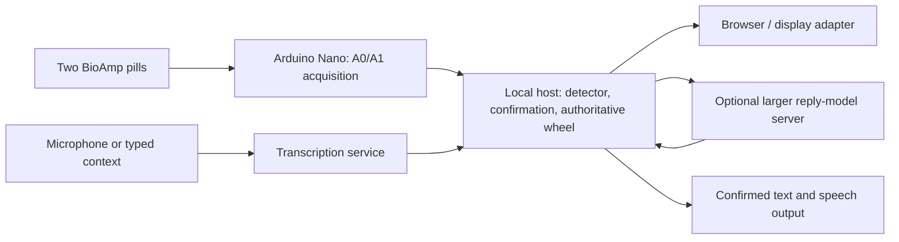

# Gaze, blink confirmation, and reply design

Updated 2026-10-10. Experimental implementation on the detection branch;
software verification is not a live wearer result. Soldering is paused until
wire and insulation are available. The completed free-wheel recording was
stopped and preserved; no accuracy score is claimed for that unlabeled session.

## Tonight's deliverable

A wearer chooses a reachable item with a cardinal eye movement, returns to
center, and deliberately double blinks to activate it. Confirmed phrases appear
on the companion and can speak through its existing speech pipeline. The browser
requires the operator to click Enable speech. Single natural blinks do nothing.

Start **gaze + double-blink communication** on the homepage. This is a separate,
explicit opt-in from the diagnostic eye-wheel test. The default app remains
unchanged. This requires live serial input and a frozen waveform profile. Do not
start guided acquisition or speed cues at the same time. Stop communication or
use the existing Stop eye wheel test button to exit. Recenter cancels a pending
choice. Nothing automatically starts on application launch.

The communication wheel exposes only four positions:

| Gaze | Item |
| --- | --- |
| Up | First reply on this page |
| Right | Second reply on this page |
| Left | More replies, disabled on the final page |
| Down | Back, using the existing application's navigation behavior |

Two replies per page make all phrase options reachable without diagonal
classification. Diagonal slots and spelling are unavailable in this temporary
layout. Normal eight-slot keyboard/mouse mode remains available after stopping.
On Home, the existing Back operation enters Needs and confirms "Give me a moment."
Back from Needs returns Home. This behavior should be revisited for the final UX.

Gaze highlighting remains removed. The center gives instructions; Chosen item
shows the full text. A short label must not hide what will actually be spoken.

## Confirmation rules

- A newly accepted gaze at an enabled item creates a pending choice.
- The detector must finish recovery and become Ready before confirmation arms.
- A double-blink waveform must begin after arming. Blinks beginning during
  recovery cannot confirm the item later.
- The frozen profile must label it double_blink, with distance <= .08,
  competing-label distance ratio >= 1.5, and horizontal energy fraction <= .25.
  These are engineering defaults, not validated blink accuracy thresholds.
- Single blinks are not paired by a timer in this mode; a classified double-blink
  waveform is required. A one-second window may miss more widely spaced pairs.
- A choice expires ten seconds after its gaze event. Uncertainty, clipping,
  recentering, stale input, changed text/contact/selection, or manual navigation
  invalidates it. A doubtful double blink cancels it and requests another gaze.
- A confirmed choice is consumed before activation. A later double blink cannot
  repeat speech without a new accepted gaze.

The detection window remains one second. Return-to-center recovery and deliberate
confirmation add time. This implementation does not promise a two-second total
interaction or implement two-second dwell. AC-coupled signals settling do not
prove that the eyes are physically centered; the wearer must follow the prompt.

## Phrase versus word options

Assumption pending clarification: two seconds means approximate interaction
cost, rather than a requested dwell timer.

| Strategy | Example | Selection cost and role |
| --- | --- | --- |
| Preset phrases | "Yes", "No", "I need help" | Fast, available immediately and offline; first demo priority |
| Contextual full replies | Asked "Want water?", offered "Yes, please" / "Not right now" | One confirmation per reply, plus any paging; preview and approval required |
| Next-word composition | "I" then "want" then "water" | Several confirmations, plus correction and Speak; later optional composition mode |

At two seconds per confirmed word, six words already cost roughly twelve
seconds before browsing, corrections and speaking. One confirmed full reply
could cost roughly two seconds under that assumption. Neither estimate is a
measured throughput result. Two-second gaze dwell should not be implemented from
these AC-coupled signals without a separate held-gaze validation.

Recommended first demo: presets first; request contextual sentence suggestions
when the other person's speech/text is available. Retain presets during generation
and on failure. Never automatically speak an AI suggestion. Keep choice text
stable through confirmation; changing the choices invalidates a pending gaze.
Next-word generation and a revised Back action remain design decisions.

## Arduino Nano versus Jetson Orin Nano

The Arduino Nano acquires A0/A1 and streams samples; it is not the sentence model
host. The Jetson is a separate Linux computer. Proposed split:

Keep detection and wheel navigation independent of model/network availability.
Run one authoritative Application/RingState, initially on the tested laptop;
move it to Jetson only after serial, dependencies and audio checks there.
Do not send raw EOG to the sentence model. Remote replies may reduce Jetson
memory pressure but add network delay; measure rather than promise lower latency.
Jetson Orin Nano Super has 8 GB shared memory and supports generative AI;
which model fits depends on model size, quantization and other running services.
[NVIDIA specification](https://developer.nvidia.com/blog/nvidia-jetson-orin-nano-developer-kit-gets-a-super-boost/).

The existing OllamaSuggestions client accepts OLLAMA_URL and OLLAMA_MODEL and can
call an Ollama-compatible model server through an SSH tunnel. Example proposal:
local tunnel port 11435 -> server loopback port 11434; set
OLLAMA_URL=http://127.0.0.1:11435 and the actual installed model name, then restart.
Server access, hardware/model inventory and benchmark remain unprovided; no
remote service was provisioned. Do not assume any arbitrary cloud API implements
the same endpoint or authentication. ASR_URL is separately configurable.

Existing suggestions are asynchronous relative to acquisition and are rejected
if the conversation revision changed while generating. Further improvement:
queue refreshed choices until no choice is pending, so a delayed reply update
doesn't force a retry. No speculative next-word model or model switch was added.

## Acceptance checkpoint

1. Desk test with speech off: choose Up, return to Ready, double blink; expect one
   confirmed reply. Repeat with Right and More, then Back.
2. Natural single blinks and double blinks before any gaze must not activate.
3. Blink during return, diagonal/uncertain gaze, recenter, and disconnect must not
   confirm an old choice. A new gaze must be required afterward.
4. Enable speech once: one confirmed reply produces one utterance, not repeats.
5. Test with reply-model service unavailable: presets and gaze still work.
6. Record intended actions and observed confirmations, including misses and false
   selections. Existing navigation recordings do not establish blink-confirmation
   accuracy. Physical OLED synchronization and glasses optics remain unverified.

## Verification

175 unit/integration tests: 174 passed, one optional NumPy test skipped.
New tests cover recovery, single blinks, ambiguous/early double blinks, expiry,
changed content/contact, one-shot activation, four-position paging and ingest
integration. HTTP/browser simulation passed, including one confirmed browser utterance with
simulated speech playback and no paid API calls. It checks presentation and dispatch, not live
signal accuracy. See the private artifacts/browser-report/eog report for its
latest result.
