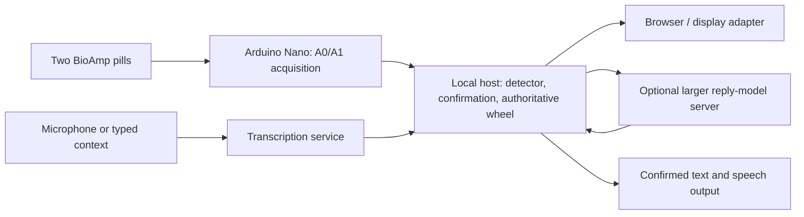

# Gaze, blink confirmation, and reply design

Updated 2026-10-10. Experimental implementation on the detection branch;
software verification is not a live wearer result. Soldering is paused until
wire and insulation are available. The completed free-wheel recording was
stopped and preserved; no accuracy score is claimed for that unlabeled session.

## Tonight's deliverable

A wearer chooses a reachable item with a cardinal eye movement, returns to
center, and deliberately double blinks to activate it. Confirmed phrases appear
on the companion and can speak through its existing speech pipeline. The browser
enables speech on that companion when the operator clicks Start gaze + double-blink
communication. Single natural blinks do nothing. A refresh resets speech to off;
Enable speech turns it back on without restarting communication.

Start **gaze + double-blink communication** on the homepage. This is a separate,
explicit opt-in from the diagnostic eye-wheel test. The default app remains
unchanged. This requires live serial input and a frozen waveform profile. Do not
start guided acquisition or speed cues at the same time. Stop communication or
use the existing Stop eye wheel test button to exit. Recenter cancels a pending
choice. Nothing automatically starts on application launch.

The communication wheel exposes only four positions:

| Gaze | Item |
| --- | --- |
| Up | First reply on this page |
| Right | Second reply on this page |
| Left | More replies, disabled on the final page |
| Down | Back, using the existing application's navigation behavior |

Two replies per page make all phrase options reachable without diagonal
classification. Diagonal slots and spelling are unavailable in this temporary
layout. Normal eight-slot keyboard/mouse mode remains available after stopping.
On Home, the existing Back operation enters Needs and confirms "Give me a moment."
Back from Needs returns Home. This behavior should be revisited for the final UX.

Gaze highlighting remains removed. A fixed Detected choice card above the wheel shows the full text; the center
shows the chosen label and Return to center / Ready to confirm status. The
companion phone continues to show confirmed speech, not pending choices. A short label must not hide what will actually be spoken.

## Confirmation rules

- A newly accepted gaze at an enabled item creates a pending choice.
- Confirmation arms after navigation becomes Ready, or after a classified
  opposite return and about 250 ms of buffered settling. This separates blink
  readiness from the longer navigation recovery. Horizontal returns require
  horizontal settling; vertical returns require both axes to settle first.
  Once armed, vertical blink activity does not disarm the choice. A later
  classified movement cancels it. This is electrical return evidence, not an
  absolute eye-position measurement.
- A double-blink waveform must begin after the signal-based arming time.
  Buffered settling can precede the delayed return classification; blinks before
  that settling time still cannot confirm.
- The frozen profile must label it double_blink, with distance <= .08,
  competing-label distance ratio >= 1.5, and horizontal energy fraction <= .25.
  A second, narrower allowance accepts distance <= .2 only with ratio >= 2.5
  and horizontal energy fraction <= .1. This tolerates larger waveform differences
  only when class separation and vertical dominance are stronger.
  These are engineering defaults, not validated blink accuracy thresholds.
- Single blinks are not paired by a timer in this mode; a classified double-blink
  waveform is required. A one-second window may miss more widely spaced pairs.
- A choice expires ten seconds after its gaze event. Uncertainty, clipping,
  recentering, stale input, changed text/contact/selection, or manual navigation
  invalidates it. A doubtful double blink cancels it and requests another gaze.
- A confirmed choice is consumed before activation. A later double blink cannot
  repeat speech without a new accepted gaze.

The detection window remains one second. Return-to-center recovery and deliberate
confirmation add time. This implementation does not promise a two-second total
interaction or implement two-second dwell. AC-coupled signals settling do not
prove that the eyes are physically centered; the wearer must follow the prompt.

## Phrase versus word options

Assumption pending clarification: two seconds means approximate interaction
cost, rather than a requested dwell timer.

| Strategy | Example | Selection cost and role |
| --- | --- | --- |
| Preset phrases | "Yes", "No", "I need help" | Fast, available immediately and offline; first demo priority |
| Contextual full replies | Asked "Want water?", offered "Yes, please" / "Not right now" | One confirmation per reply, plus any paging; preview and approval required |
| Next-word composition | "I" then "want" then "water" | Several confirmations, plus correction and Speak; later optional composition mode |

At two seconds per confirmed word, six words already cost roughly twelve
seconds before browsing, corrections and speaking. One confirmed full reply
could cost roughly two seconds under that assumption. Neither estimate is a
measured throughput result. Two-second gaze dwell should not be implemented from
these AC-coupled signals without a separate held-gaze validation.

Recommended first demo: presets first; request contextual sentence suggestions
when the other person's speech/text is available. Retain presets during generation
and on failure. Never automatically speak an AI suggestion. Keep choice text
stable through confirmation; changing the choices invalidates a pending gaze.
Next-word generation and a revised Back action remain design decisions.

## Arduino Nano versus Jetson Orin Nano

The Arduino Nano acquires A0/A1 and streams samples; it is not the sentence model
host. The Jetson is a separate Linux computer. Proposed split:

Keep detection and wheel navigation independent of model/network availability.
Run one authoritative Application/RingState, initially on the tested laptop;
move it to Jetson only after serial, dependencies and audio checks there.
Do not send raw EOG to the sentence model. Remote replies may reduce Jetson
memory pressure but add network delay; measure rather than promise lower latency.
Jetson Orin Nano Super has 8 GB shared memory and supports generative AI;
which model fits depends on model size, quantization and other running services.
[NVIDIA specification](https://developer.nvidia.com/blog/nvidia-jetson-orin-nano-developer-kit-gets-a-super-boost/).

The existing OllamaSuggestions client accepts OLLAMA_URL and OLLAMA_MODEL and can
call an Ollama-compatible model server through an SSH tunnel. Example proposal:
local tunnel port 11435 -> server loopback port 11434; set
OLLAMA_URL=http://127.0.0.1:11435 and the actual installed model name, then restart.
Server access, hardware/model inventory and benchmark remain unprovided; no
remote service was provisioned. Do not assume any arbitrary cloud API implements
the same endpoint or authentication. ASR_URL is separately configurable.

Existing suggestions are asynchronous relative to acquisition and are rejected
if the conversation revision changed while generating. Further improvement:
queue refreshed choices until no choice is pending, so a delayed reply update
doesn't force a retry. No speculative next-word model or model switch was added.

## Acceptance checkpoint

1. Desk test with speech off: choose Up, return to Ready, double blink; expect one
   confirmed reply. Repeat with Right and More, then Back.
2. Natural single blinks and double blinks before any gaze must not activate.
3. Blink during return, diagonal/uncertain gaze, recenter, and disconnect must not
   confirm an old choice. A new gaze must be required afterward.
4. Enable speech once: one confirmed reply produces one utterance, not repeats.
5. Test with reply-model service unavailable: presets and gaze still work.
6. Record intended actions and observed confirmations, including misses and false
   selections. Existing navigation recordings do not establish blink-confirmation
   accuracy. Physical OLED synchronization and glasses optics remain unverified.

## Verification

182 unit/integration tests: 181 passed, one optional NumPy test skipped.
New tests cover recovery, single blinks, ambiguous/early double blinks, expiry,
changed content/contact, one-shot activation, four-position paging and ingest
integration. HTTP/browser simulation passed, including one confirmed browser utterance with
simulated speech playback and no paid API calls. It checks presentation and dispatch, not live
signal accuracy. See the private artifacts/browser-report/eog report for its
latest result.

## Double-blink rejection review

The wearer reported deliberate double blinks being marked uncertain. In the
latest private live event log inspected, 13 events were classified double_blink.
The original match gate admitted two waveform candidates; the revised gate
admits four. These are waveform eligibility counts, not four confirmations or
an accuracy score: pending-choice, recovery and onset conditions still apply.

Replaying the three reviewed recordings through the frozen all-data profile
produced the same eligible-event counts under old and selected revised rules:
four during the double-blink movement cues, no additions during single-blink
movement cues, and unchanged candidates in baseline/prepare/return periods.
An intermediate ratio >= 2 rule added a baseline candidate and was tightened to
>= 2.5. This tuning reuses development data and is not independent validation.
Existing baseline candidates remain a reason to validate false confirmations.
Private report: recordings/blink-policy-review.json.

Double-blink events now log confirmation_result: selected, no_pending_choice,
return_to_center_first, early_blink, or uncertain_blink_match. No new live wearer
result is claimed after this adjustment.

## Recovery-blocking bug found in the next live session

The wearer reported worse usability and double blinks still not selecting. The
next session logged recognized, strongly matched double blinks rejected as
return_to_center_first. Vertical blink masks repeatedly cleared the full quiet
period, and the app started a further settling wait after the one-second return
classifier had already buffered the return. The prior distance allowance did not
address this interaction defect.

GuidedEOGTest now retains the last two seconds of filtered frames and the
opposite-return onset. Confirmation can arm from a contiguous ~250 ms settling
interval after that return, independently of navigation recovery. Once armed,
a blink's own vertical activity does not restart settling. Subsequent classified
movement, uncertainty, faults, changed content and expiry still cancel it.
Direction matching, its thresholds, profile and single-blink behavior are unchanged.

Raw-only old/new replay of the first enabled interval in the latest recording
produced two versus six activations, one versus five phrase confirmations, and
16 versus six double blinks blocked waiting for return. UI actions are not in
the replay and intended actions are unlabeled; these are behavior differences,
not accuracy estimates or proof of correct activations. Private report:
recordings/recovery-confirmation-review.json.

A simulated communication replay of the three reviewed recordings produced
unchanged selection counts: two in prepare intervals for session4, none in
session5, two in double-blink cues for session6. Existing prepare selections are
a false-confirmation risk and are not dismissed. Frozen all-data profile and
reused data limit this check. Private report: recordings/confirmation-regression-review.json.

The live diagnostic session also logged five clipping resets and thirteen
rejected movements. These counts do not establish direction accuracy; rails and
contact/movement artifacts can interrupt operation. No new wearer result is
claimed for the recovery fix. Next checkpoint: one known reply, return, confirm
with speech off, then natural blinks/no-choice checks.

### 2026-10-10: double-blink ambiguity instrumentation

The latest explicit right → center → double-blink attempt reached an armed gate but failed the single-versus-double template margin (1.218 versus 1.5). Waveform events now include completed vertical-pulse count, widths, separation, ratio and valley diagnostics. These are observational only; selection thresholds remain unchanged pending exact-window replay. Some reused single-blink/direction windows also contain two lobes, so pulse count alone must not authorize selection. Confirmation armed indices now use the same logging coordinate as onset/emitted indices. See `CLAUDE_HANDOFF.md` for the exact event, replay alignment blocker and next experiment.

### Speech on communication start

Starting communication now enables speech on the companion through the same user click.
The local `.env` configures ElevenLabs: confirmed replies use cloud TTS with a local
cache and browser speech fallback. No credentials are stored in these docs. Browser
audio policy can still require interaction; this is not an audible hardware test.
The speech toggle can pause output; refresh starts with speech off. Diagnostic mode
continues to disable speech. Automated browser checks use mocked browser speech and
disable the cloud API key, so they never call paid TTS.
